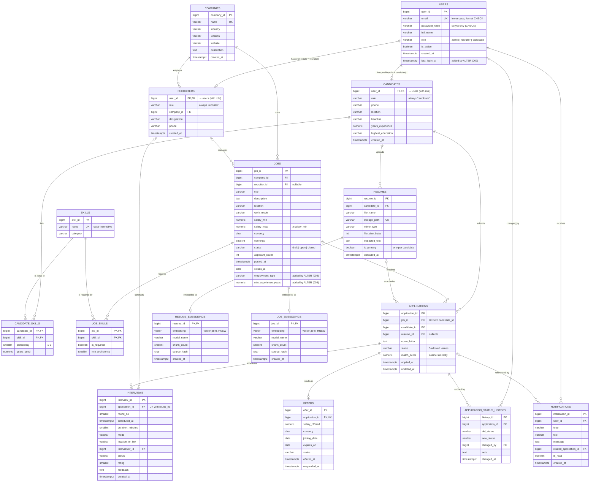

# TalentMatch — ER Diagram

This diagram is written in Mermaid `erDiagram` syntax. GitHub and VS Code (with a Mermaid extension) render it automatically. It matches `db/migrations/001–009`.

**Notation:** `||` means exactly one, `o|` zero or one, `|{` one or more, `o{` zero or more.
`PK` = primary key, `FK` = foreign key, `UK` = unique.

## Key relationship notes

| Relationship | Type | How it is enforced |
|---|---|---|
| users → recruiters / candidates | 1 : 0..1 (specialisation) | The profile's PK is also its FK to `users`. A composite FK `(user_id, role)` makes sure only a user with role `recruiter` can have a recruiter profile, and likewise for candidates. |
| companies → recruiters | 1 : N | `recruiters.company_id` FK |
| companies → jobs | 1 : N | `jobs.company_id` FK |
| recruiters → jobs | 1 : N (optional) | Composite FK `(recruiter_id, company_id)`, so a recruiter can only manage jobs of their own company |
| candidates ↔ skills | M : N | Junction table `candidate_skills` with composite PK |
| jobs ↔ skills | M : N | Junction table `job_skills` with composite PK |
| candidates ↔ jobs | M : N through `applications` | `UNIQUE (job_id, candidate_id)`: one application per job per candidate |
| applications → offers | 1 : 0..1 | `UNIQUE (application_id)` on `offers` |
| applications → interviews | 1 : N | `UNIQUE (application_id, round_no)` |
| resumes → resume_embeddings | 1 : 0..1 | Embedding PK = FK to `resumes` |
| jobs → job_embeddings | 1 : 0..1 | Embedding PK = FK to `jobs` |
