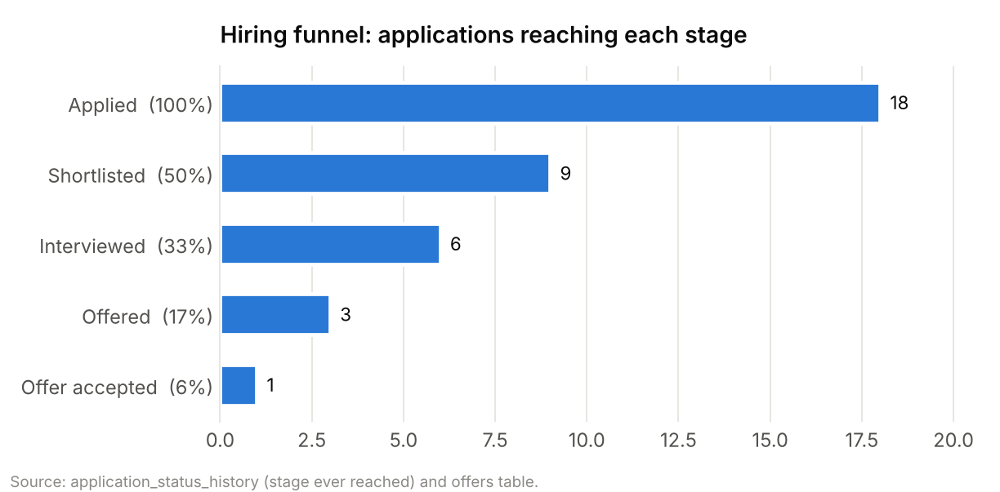
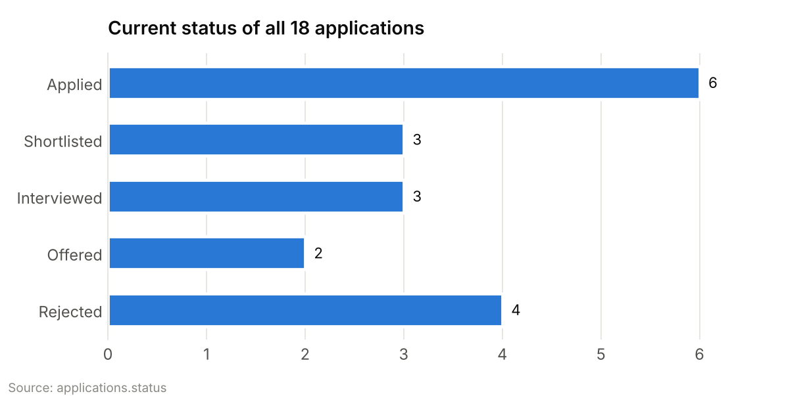
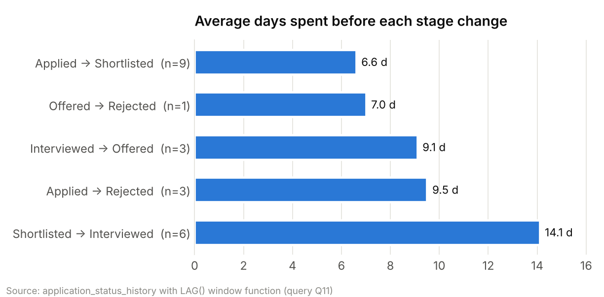
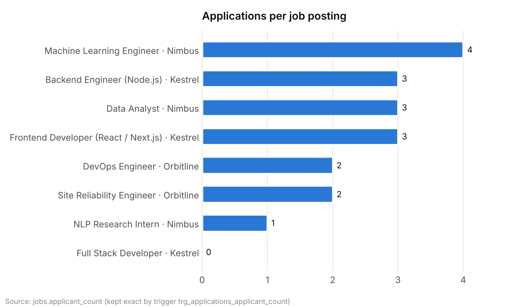
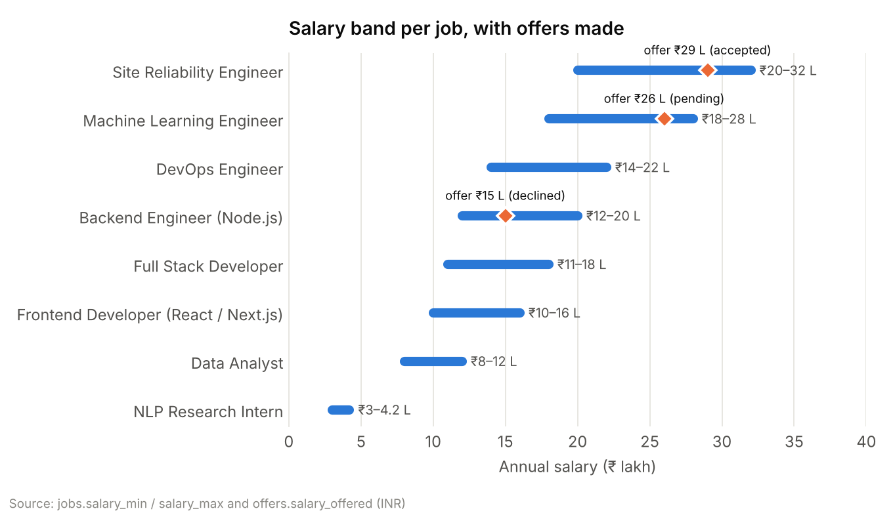
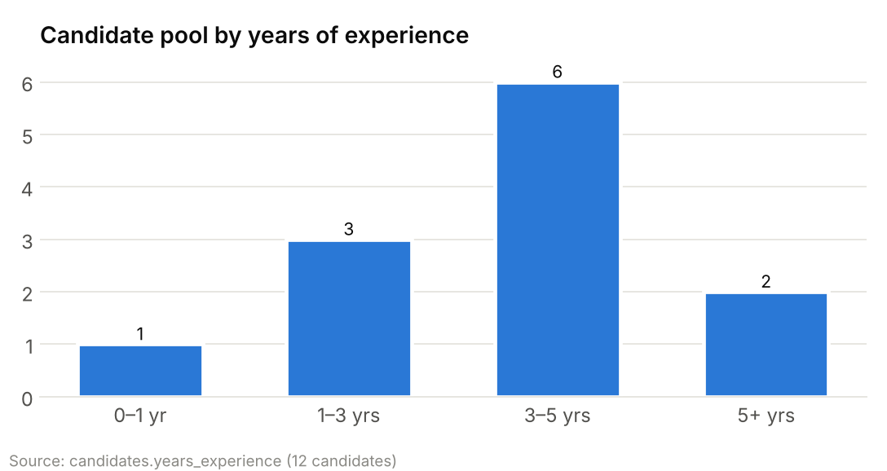
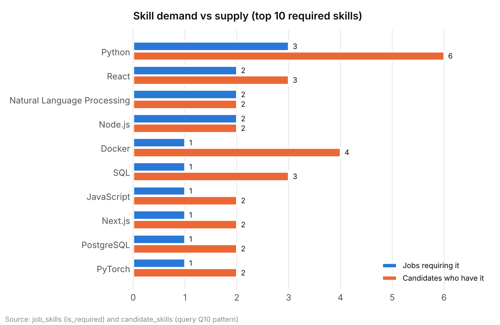
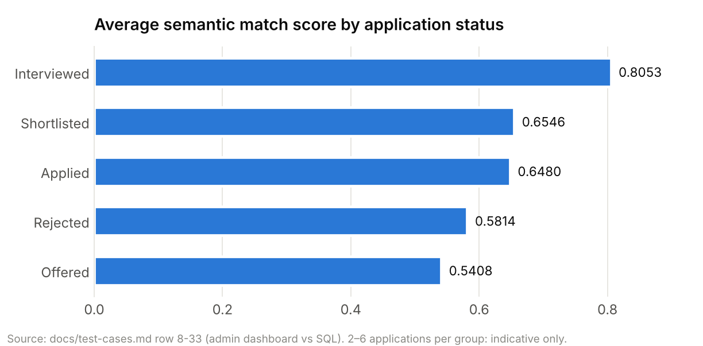
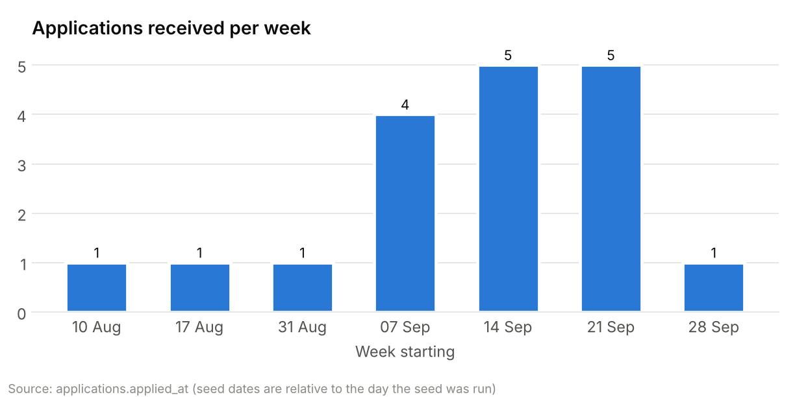

# TalentMatch — Hiring Statistics Report

*Treating TalentMatch as a company: what the hiring data in the platform says.*

This report reads TalentMatch the way a hiring manager or business analyst would: how many people applied, how far they got, how long each stage took, what the company is paying, which skills are scarce, and where the process could improve.

**Data source.** All figures come from the project's own database: migrations `001–024` followed by `npm run db:seed` (`db/seed/seed.sql`). The seed sets every date relative to the day it is run, so this report describes the hiring period of roughly seven weeks before that day. Match scores come from the embedding run recorded in `docs/test-cases.md` and `docs/vector-design.md`. All people and companies are fictional.

**Caution on sample size.** The demo dataset has 18 applications. Percentages are shown to describe this dataset, not to predict real-world hiring rates.

---

## 1. Executive summary

| Metric | Value |
|---|---|
| Client companies | 3 |
| Recruiters | 4 |
| Candidates registered | 12 |
| Job postings | 8 (6 open, 1 closed, 1 draft) |
| Positions to fill (openings) | 14 |
| Applications received | 18 (1.5 per candidate) |
| Interviews held / scheduled | 7 completed, 2 upcoming |
| Offers made | 3 (1 accepted, 1 declined, 1 pending) |
| Hires | 1 |
| Shortlist rate | 50% of applications |
| Offer rate | 17% of applications |
| Offer acceptance rate | 50% of decided offers (1 of 2) |
| Average interview rating | 4.29 / 5 (7 rated interviews) |
| Time to hire (one completed hire) | 22.0 days from application to acceptance |

**Key findings**

1. **Strong top of the funnel, slow middle.** Half of all applications are shortlisted, but the shortlist-to-interview step takes **14.1 days on average**, more than twice as long as screening (6.6 days). This is the main bottleneck.
2. **Demand is uneven.** The Machine Learning Engineer role attracts the most applicants (4), while the NLP internship has only 1 applicant for 2 openings.
3. **Python is the most demanded skill** (required by 3 jobs) and also the most common in the candidate pool (6 candidates). Skills such as Terraform, Kubernetes, Express, AWS and Power BI have only **one** candidate each: a single-source risk.
4. **Offers are competitive within their bands.** Two of three offers sit in the top quarter of the job's salary range; the one offer made at 37.5% of its band was declined.
5. **Semantic matching surfaces non-obvious candidates.** For the ML role, the second-ranked candidate matched only 1 of 3 listed skills but described closely related deep-learning work, which keyword screening would have missed.

---

## 2. Hiring funnel



| Stage reached | Applications | % of all | Conversion from previous stage |
|---|---|---|---|
| Applied | 18 | 100% | — |
| Shortlisted | 9 | 50% | 50% |
| Interviewed | 6 | 33% | 67% |
| Offered | 3 | 17% | 50% |
| Offer accepted | 1 | 6% | 50% of offers (1 still pending) |

"Stage reached" counts every application that ever entered that stage, read from the `application_status_history` audit table, so applications that later moved on or were rejected are still counted at the stages they passed.

### Where applications stand today



| Status | Applications | Share |
|---|---|---|
| Applied (awaiting screening) | 6 | 33% |
| Shortlisted | 3 | 17% |
| Interviewed | 3 | 17% |
| Offered | 2 | 11% |
| Rejected | 4 | 22% |

Rejections happened at two points: **3 at screening** (applied → rejected) and **1 after an offer** (offered → rejected, when an offer was withdrawn). One third of applications are still waiting for a first decision.

---

## 3. Speed of the process



| Stage change | Count | Average | Fastest | Slowest |
|---|---|---|---|---|
| Applied → Shortlisted | 9 | 6.6 days | 5.0 | 9.8 |
| Offered → Rejected | 1 | 7.0 days | 7.0 | 7.0 |
| Interviewed → Offered | 3 | 9.1 days | 6.8 | 10.7 |
| Applied → Rejected | 3 | 9.5 days | 7.2 | 12.6 |
| Shortlisted → Interviewed | 6 | 14.1 days | 7.2 | 24.3 |

| Offer | Days from application to offer | Days to candidate's answer |
|---|---|---|
| Site Reliability Engineer (accepted) | 19.1 | 22.0 |
| Backend Engineer (declined) | 22.6 | 28.9 |
| Machine Learning Engineer (pending) | 40.6 | — |

**Reading:** screening is quick (under a week on average), but scheduling interviews after shortlisting is slow and variable (up to 24 days). Rejecting candidates at screening takes longer (9.5 days) than shortlisting them (6.6 days), so unsuccessful candidates wait longest for an answer. Average time to offer across the three offers is **27.4 days**.

Computed with the `LAG()` window function over the audit table (query Q11 in `db/queries/important_queries.sql`).

---

## 4. Demand by company and by job

| Company | Jobs (open) | Openings | Applications | Applications per job | Offers |
|---|---|---|---|---|---|
| Nimbus Analytics Pvt Ltd | 3 (3) | 7 | 8 | 2.7 | 1 pending |
| Kestrel Software Labs | 3 (2) | 4 | 6 | 2.0 | 1 declined |
| Orbitline Cloud Systems | 2 (1) | 3 | 4 | 2.0 | 1 accepted |
| **Total** | **8 (6)** | **14** | **18** | **2.25** | **3** |



| Job | Company | Mode | Type | Min. experience | Openings | Applications |
|---|---|---|---|---|---|---|
| Machine Learning Engineer | Nimbus | Hybrid | Full-time | 2 yrs | 2 | 4 |
| Backend Engineer (Node.js) | Kestrel | Onsite | Full-time | 2 yrs | 1 | 3 |
| Data Analyst | Nimbus | Onsite | Full-time | 1 yr | 3 | 3 |
| Frontend Developer (React / Next.js) | Kestrel | Hybrid | Full-time | 1.5 yrs | 2 | 3 |
| DevOps Engineer | Orbitline | Hybrid | Full-time | 3 yrs | 2 | 2 |
| Site Reliability Engineer | Orbitline | Onsite | Full-time | 4 yrs | 1 | 2 (closed) |
| NLP Research Intern | Nimbus | Remote | Internship | 0 yrs | 2 | 1 |
| Full Stack Developer | Kestrel | Remote | Contract | 2 yrs | 1 | 0 (draft) |

**Reading:** Nimbus has the most open positions (7) and the most applicants. Among open jobs, applicants per opening range from 3.0 (Backend Engineer) and 2.0 (Machine Learning Engineer) down to 1.0 (Data Analyst, DevOps Engineer) and 0.5 (NLP Research Intern: 1 applicant for 2 openings). The NLP internship is the least competitive role and the most likely to stay unfilled. Job mix: 3 hybrid, 3 onsite, 2 remote; 6 full-time, 1 internship, 1 contract.

### Recruiter workload

| Recruiter | Designation | Company | Jobs managed | Applications handled |
|---|---|---|---|---|
| Kavya Menon | Engineering Recruiter | Kestrel | 3 | 6 |
| Meera Iyer | Senior Talent Partner | Nimbus | 2 | 5 |
| Rahul Kamath | Technical Recruiter | Orbitline | 2 | 4 |
| Arjun Rao | Talent Acquisition Lead | Nimbus | 1 | 3 |

---

## 5. Compensation



| Job | Salary band (₹ lakh / year) | Offer | Position in band | Outcome |
|---|---|---|---|---|
| Site Reliability Engineer | 20 – 32 | 29 | 75% | Accepted |
| Machine Learning Engineer | 18 – 28 | 26 | 80% | Pending |
| Backend Engineer (Node.js) | 12 – 20 | 15 | 37.5% | Declined |

*Position in band = (offer − minimum) ÷ (maximum − minimum).*

| Summary | Value |
|---|---|
| Average offer | ₹23.3 lakh |
| Highest band | Site Reliability Engineer, ₹20–32 lakh |
| Lowest band | NLP Research Intern, ₹3–4.2 lakh |
| Average band midpoint across the 8 jobs | ₹15.5 lakh |

**Reading:** with only three offers this is not a trend, but the pattern is consistent with common practice: the offer near the bottom of its band was the one declined.

This is the platform's equivalent of the classic "average salary per department" report. The query:

```sql
SELECT co.name AS company, count(*) AS offers, round(avg(o.salary_offered)) AS avg_salary_offered
FROM offers o
JOIN applications a USING (application_id)
JOIN jobs j         USING (job_id)
JOIN companies co   USING (company_id)
GROUP BY co.name
ORDER BY avg_salary_offered DESC;
```

---

## 6. Talent pool and skills

### Candidate profile



| Experience | Candidates |
|---|---|
| Under 1 year | 1 |
| 1 – 3 years | 3 |
| 3 – 5 years | 6 |
| 5 years and more | 2 |

Average experience is 3.1 years. Candidates are spread across 8 cities, led by Bengaluru (3), Pune (2) and Hyderabad (2). Education is mostly engineering degrees (B.Tech / B.E: 7 of 12), plus MCA, M.Tech, M.Sc Statistics, B.Sc Economics and BBA. Each candidate lists 4.25 skills on average (51 skill entries) with an average self-rated proficiency of 3.86 / 5.

### Skill demand vs supply



| Skill | Jobs requiring it | Candidates who have it | Candidates per requiring job |
|---|---|---|---|
| Python | 3 | 6 | 2.0 |
| React | 2 | 3 | 1.5 |
| Natural Language Processing | 2 | 2 | 1.0 |
| Node.js | 2 | 2 | 1.0 |
| Docker | 1 | 4 | 4.0 |
| SQL | 1 | 3 | 3.0 |
| Terraform, Kubernetes, Linux, AWS, Express, Power BI | 1 each | 1 each | 1.0 |

**Reading:** NLP and Node.js are each required by two jobs but held by only two candidates, and six infrastructure and data skills have exactly one candidate. These are the skills to source more actively. Docker and SQL are well supplied.

### Required-skill coverage of applicants

| Measure | Value |
|---|---|
| Average share of a job's required skills that applicants meet at the required level | 64.8% |
| Applications meeting **all** required skills | 8 of 18 (44%) |

| Current status | Avg. required-skill coverage |
|---|---|
| Interviewed | 100.0% |
| Shortlisted | 88.9% |
| Applied | 65.3% |
| Rejected | 43.8% |
| Offered | 16.7% |

**Reading:** recruiters tend to shortlist and interview candidates who tick the listed skills. The two applications currently at *offered* have low listed-skill coverage. That is where semantic matching matters: candidates can describe the needed experience in their resume without listing the exact skill tags (see section 7).

---

## 7. Semantic matching

The platform scores every application with the cosine similarity between the resume's embedding and the job's embedding (`compute_match_score()`, stored in `applications.match_score`).

### Ranking example: Machine Learning Engineer

| Rank | Candidate | Similarity | Required skills met |
|---|---|---|---|
| 1 | Aditi Sharma | 0.7819 | 3 / 3 |
| 2 | Rohan Verma | 0.6658 | 1 / 3 |
| 3 | Divya Krishnan | 0.5032 | 3 / 3 |
| 4 | Ishita Banerjee | 0.4378 | 0 / 3 |
| … | … | … | … |
| 12 | Sneha Kulkarni (frontend profile) | 0.2438 | 0 / 3 |

For the Frontend Developer job the order reverses: Sneha Kulkarni ranks first (0.7552) and the best ML/data candidate, Aditi Sharma, ranks eighth (0.2619). Source: `docs/vector-design.md`.

### Average match score by application status



| Status | Average match score |
|---|---|
| Interviewed | 0.8053 |
| Shortlisted | 0.6546 |
| Applied | 0.6480 |
| Rejected | 0.5814 |
| Offered | 0.5408 |

Source: `docs/test-cases.md` row 8-33 (admin dashboard checked against SQL). Interviewed candidates have the highest average similarity. With 2–6 applications per group the order is **indicative only** and is not evidence that the score predicts hiring outcomes.

---

## 8. Interviews

| Measure | Value |
|---|---|
| Interviews | 9 (7 completed, 2 scheduled) |
| By mode | Video 6, Onsite 2, Phone 1 |
| Average planned duration | 67 minutes |
| Ratings given | 7, all between 4 and 5 |
| Average rating | 4.29 / 5 (video 4.40, onsite 4.00, phone 4.00) |

Interview ratings are uniformly high, so the rating alone does not separate candidates. A wider rating spread or a structured scorecard would make interviews more decision-useful.

---

## 9. Activity over time



Applications arrived over about seven weeks, with a peak of **14 applications in three consecutive weeks** in the middle of the period. The platform sent 10 in-app notifications for pipeline events (offers made 3, offer responses 2, interviews scheduled 2, applications submitted 2, status changes 1).

---

## 10. Recommendations

1. **Cut the shortlist-to-interview delay.** It averages 14.1 days and reaches 24. A target of 7 days would bring the average time to offer under three weeks.
2. **Answer rejected candidates faster.** Screening rejections take longer than shortlisting. Close them out within the same week.
3. **Promote the NLP Research Intern role.** It has 0.5 applicants per opening, the weakest ratio of any open job; Data Analyst and DevOps Engineer follow at 1.0.
4. **Source for scarce skills.** NLP, Node.js and single-candidate infrastructure skills (Terraform, Kubernetes, AWS) need a deeper pool.
5. **Review offers below the band midpoint.** The only declined offer was at 37.5% of its band.
6. **Use semantic score and skill coverage together.** Neither alone tells the full story; the ranked-applicants view already shows both side by side.

---

## Appendix: how the numbers were produced

| Section | Query / source |
|---|---|
| Summary counts | `SELECT count(*)` on each table |
| Funnel | `application_status_history` (distinct applications per `new_status`) and `offers.status` |
| Speed | `LAG(changed_at) OVER (PARTITION BY application_id ORDER BY changed_at)` (query Q11) |
| Company and job tables | `companies`, `jobs`, `applications` with GROUP BY; `jobs.applicant_count` |
| Compensation | `jobs.salary_min / salary_max`, `offers.salary_offered` |
| Skills | `job_skills` and `candidate_skills` with `count(DISTINCT …)` (query Q10 pattern); coverage uses the correlated subqueries of query Q8 |
| Match scores | `docs/vector-design.md`, `docs/test-cases.md` row 8-33 |
| Interviews | `interviews` grouped by `mode` and `status` |

Charts are in `docs/statistics/`.
